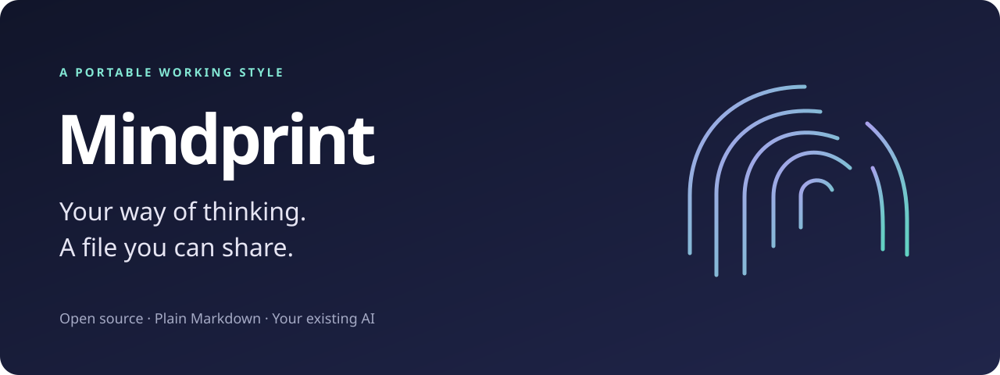

<p align="center"></p>

<p align="center"><strong>Turn your working style into an AI skill your coworkers and friends can use.</strong></p>
<p align="center">Plain Markdown · Your existing AI · No Mindprint account · MIT licensed</p>

You have a way of making decisions, giving feedback, and explaining things. Most of it lives in conversations.

**Mindprint helps your AI distill those patterns into a small, readable file.** Share the reviewed version with someone, and they can ask their AI to approach a problem through your lens—without handing over the conversations that shaped it.

> “Review this plan using my cofounder's Mindprint. What tradeoffs would this profile highlight?”
>
> “Give me feedback using my editor's working style.”
>
> “Use my friend's learning preferences to help me explain this idea.”

It's a model of someone's preferences, not their presence, permission, or approval.

## Try it in your next chat

**No terminal needed.** Download [START-HERE.md](https://raw.githubusercontent.com/willfeldman/mindprint/main/START-HERE.md), attach it to an AI that accepts text files, and say:

```text
Create my Mindprint using this workflow.
Use the history you can actually access, plus examples I choose to share.
If you need more evidence, interview me.
Remove private details, show me the full draft, and help me review it
before I share it. Don't publish anything.
```

Can't attach files? [Open the text](START-HERE.md), copy it, and paste it into your chat. No chat history access? It interviews you. No file tools? It returns complete files as text for you to save.

**Already use agent skills?** Install this repository's `SKILL.md` and `references/` together. [Native installation instructions →](docs/compatibility.md)

## What comes out

```text
my-mind/
├── SKILL.md       Instructions for skill-compatible agents
├── MIND.md        The same working model as plain Markdown
├── ABOUT.md       Scope, confidence, and limitations
├── scenarios.md   Synthetic situations to check the model against
└── REVIEW.md      Privacy, fidelity, and sharing status
```

The AI creates the profile and review files. The optional local packer creates `MIND.md` and an allowlisted ZIP after your review. In chat-only mode, ask the AI for the complete Markdown files directly.

[See a complete fictional example →](examples/sample-mind/SKILL.md)

### What makes a useful Mindprint?

| Generic profile | Useful instruction |
|---|---|
| “I'm creative.” | “For an unclear creative direction, show two contrasting sketches. Once a direction is selected, refine it instead of reopening the choice.” |
| “I care about quality.” | “During exploration, focus on the issue that changes the concept. At final delivery, check consistency and detail.” |
| “I'm decisive.” | “Prototype reversible choices. Surface assumptions before an expensive commitment.” |

The interesting part is the **when**, the **why**, and the **exception**.

## How it works

1. **Find the patterns.** Your AI reviews authorized examples, especially your corrections and follow-ups, or asks a few focused questions.
2. **Write the rules.** It translates observations into conditional instructions, with confidence and exceptions.
3. **Remove private details.** It abstracts the useful behavior and leaves source conversations, identities, and confidential context out of the export.
4. **Try the model.** Synthetic scenarios reveal whether it changes the answer in a useful way—or just sounds flattering.
5. **You review.** Correct what feels wrong and approve the exact version before it goes to anyone else.
6. **Share the file.** Your recipient attaches `MIND.md` or installs the skill. Their current instructions still take precedence.

## Built to travel

The core workflow and generated profiles are plain text. There is no required model API, memory service, browser extension, or vendor-specific tool.

- **Native skills:** structured for the open [Agent Skills format](https://agentskills.io/specification); setup guidance for Claude Code, Codex, and Cursor.
- **Other chat assistants:** attach or paste the standalone starter; use the generated `MIND.md` as context.
- **Different capabilities:** history, interview, file-writing, and chat-only routes are explicit.

This is format portability, not a claim of identical behavior on every model. The assistant needs to follow instructions and handle the document length. [Compatibility and tested scope →](docs/compatibility.md)

## Privacy is a review process

**Share the working style. Keep the source conversations out of the export.**

Mindprint has no hosted backend or telemetry. Its optional helper scripts run locally with no network calls. Your AI provider still processes whatever you give it under its own policies.

The workflow removes identifying and sensitive source details, avoids private quotes, and requires owner review before sharing. A local heuristic checker can flag common leak patterns. It cannot guarantee anonymity or detect every sensitive implication. **Preferences are personal information too.** Read the actual output before sharing it.

Use it for yourself, or invite someone to make their own. Don't build a model of an unconsenting coworker from their private messages. Don't submit real profiles or chat exports in issues or PRs. [Privacy approach →](references/privacy.md)

## Optional local tools

Python 3.10+; standard library only. These tools do not generate a profile or call an AI. They help check and package the profile your agent creates.

```bash
# Run from the cloned repository.
python3 scripts/mindprint.py check /path/to/my-mind

# Optional: local terms that must never appear in the export, one per line.
# Keep this file outside the profile folder. It is never bundled.
python3 scripts/mindprint.py check /path/to/my-mind --exclude-file /private/exclusions.txt

# Only after the owner has reviewed and approved these exact files.
python3 scripts/mindprint.py pack /path/to/my-mind --output my-mind.zip --reviewed
```

The packer refuses extra files, symlinks, suspicious patterns, and existing output files. The input folder must contain exactly `SKILL.md`, `ABOUT.md`, `scenarios.md`, and `REVIEW.md`; keep raw inputs elsewhere. `--reviewed` is your assertion of approval, not a privacy certificate. [Tool limitations and validation →](docs/validation.md)

## Why I made this

I asked an AI to study our back-and-forth and distill how I frame problems, evaluate evidence, and respond to feedback. The useful result was a set of specific decision rules with exceptions.

Mindprint makes that process reusable: start with evidence, remove private context, test what survives, and let the person correct the result.

— Will Feldman

## Help make it better

Try it on yourself. Tell us which **synthetic** scenario revealed a weak rule or a portability issue. We welcome better evaluation cases, clearer interviews, and privacy improvements. [Contributing →](CONTRIBUTING.md)

If this is useful, star the repo and send the starter to someone who keeps saying, “That's not quite how I'd approach it.”

[MIT license](LICENSE). The tool's license does not automatically license or make public the profiles you create.
